<p align="center">
  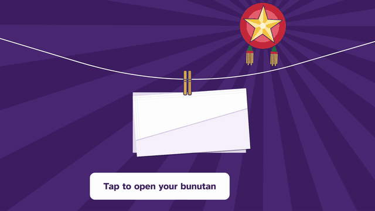
</p>

<p align="center">
  <a href="https://monitomonita-ph.vercel.app"></a>
  <a href="https://monitomonita-ph.vercel.app/demo"></a>
  <a href="https://youtu.be/DBNKbfwfE50"></a>
  <a href="https://pagespeed.web.dev/analysis?url=https%3A%2F%2Fmonitomonita-ph.vercel.app%2F"></a>
  
  
</p>

<p align="center"><b>Monito Monita runs the Filipino exchange gift from one link: draw names, share wishlists, play the theme weeks and do the reveal at the party. No app, no sign-up.</b></p>

## What it is

Every December, Filipino families, barkadas and offices run *Monito Monita*: a secret gift exchange. Names are drawn as a *bunutan* (folded paper slips pulled from a bowl), the weeks before the party have themes ("something soft", "something sweet", "something red"), and at the party each person reveals who they had.

Today this runs on a Messenger group chat, a spreadsheet and someone's memory. Monito Monita puts it in one link that people open from the GC on their phones. The organizer creates the group; everyone else just taps the link.

## See it in 51 seconds

<p align="center">
  <a href="https://youtu.be/DBNKbfwfE50">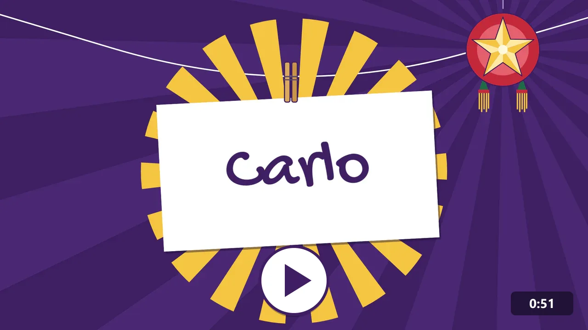</a>
</p>

## How it works

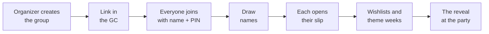

## Screenshots

<table>
  <tr>
    <td width="50%" valign="top"><br><sub>Landing</sub></td>
    <td width="50%" valign="top"><br><sub>Organizer, after the draw: 8 of 12 slips opened</sub></td>
  </tr>
</table>

<table>
  <tr>
    <td width="33%" align="center" valign="top">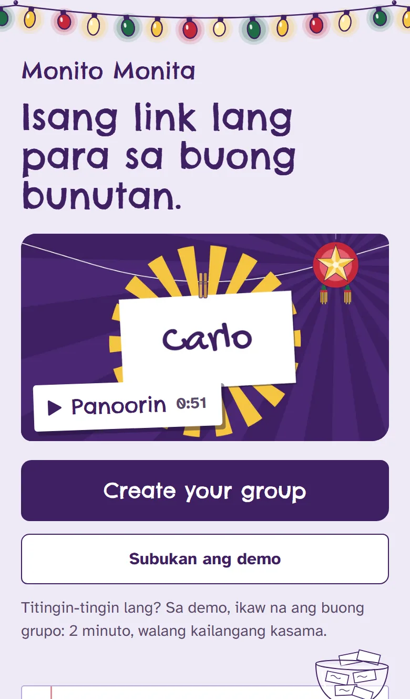<br><sub>Landing on a phone</sub></td>
    <td width="33%" align="center" valign="top">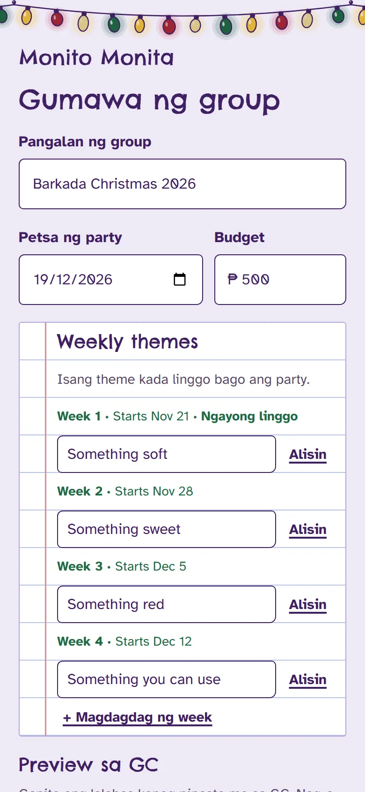<br><sub>Create a group</sub></td>
    <td width="33%" align="center" valign="top">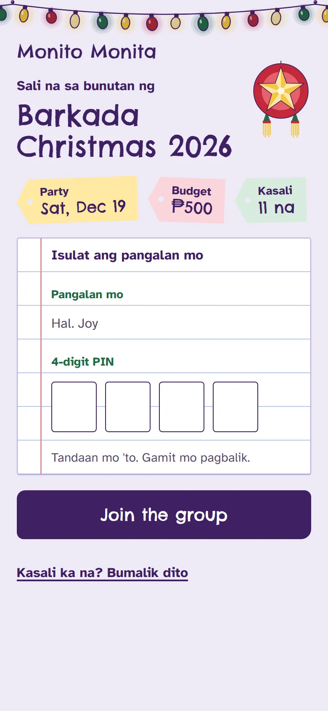<br><sub>Join with a name and PIN</sub></td>
  </tr>
  <tr>
    <td width="33%" align="center" valign="top">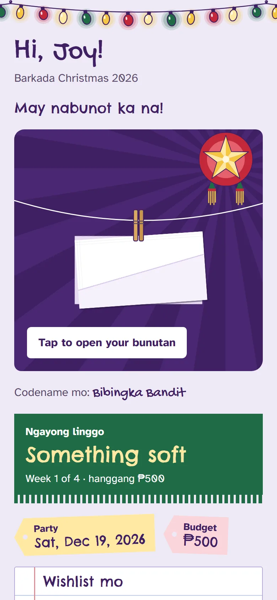<br><sub>Your slip, folded</sub></td>
    <td width="33%" align="center" valign="top"><br><sub>Opened: the wishlist and this week's theme</sub></td>
    <td width="33%" align="center" valign="top">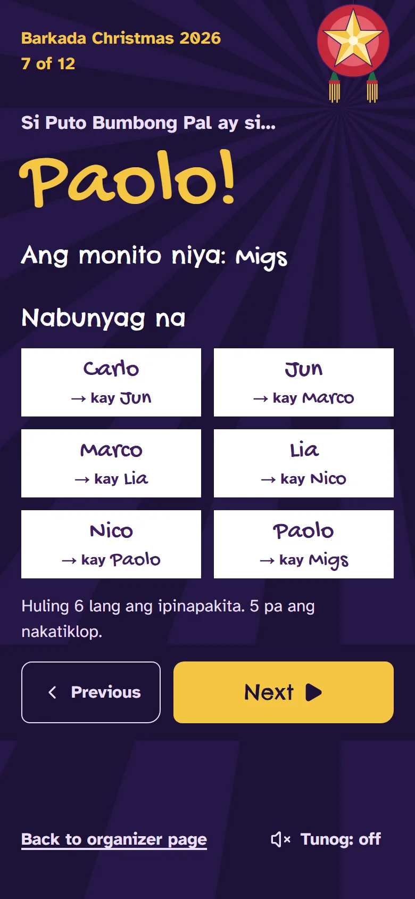<br><sub>The phone remote at the party</sub></td>
  </tr>
</table>

<table>
  <tr>
    <td width="50%" valign="top">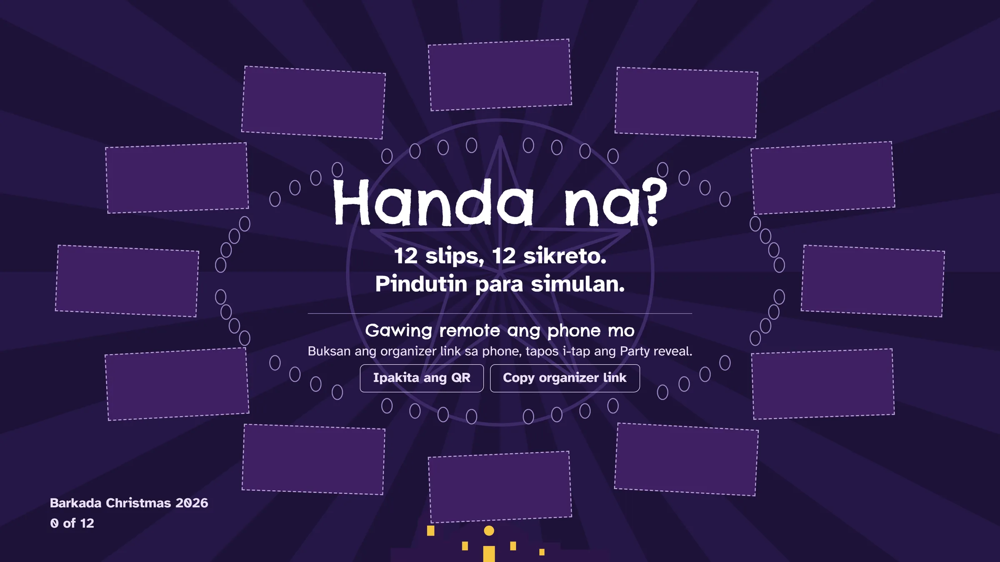<br><sub>Reveal: before the start</sub></td>
    <td width="50%" valign="top">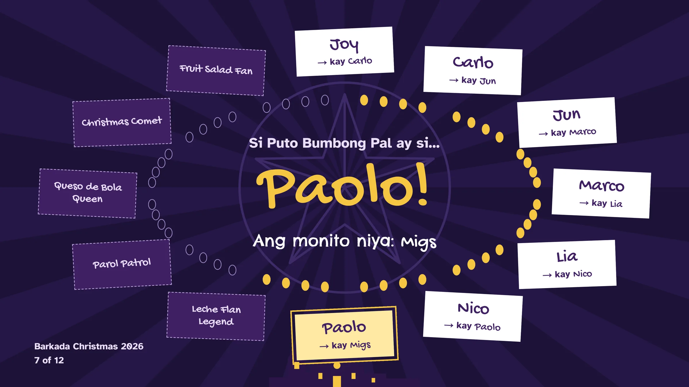<br><sub>Reveal: 7 of 12</sub></td>
  </tr>
</table>

<p align="center">
  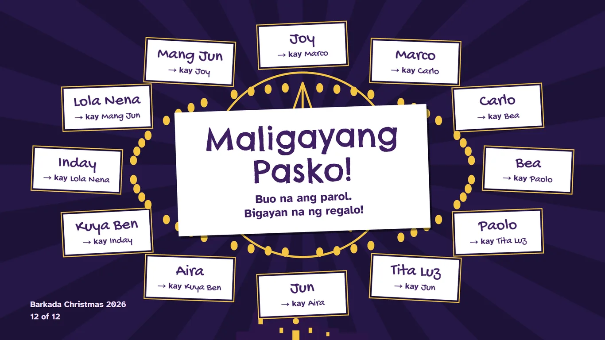
  <br><sub>The finale, on a 1920×1080 projector</sub>
</p>

## Features

- **Join with a name and a 4-digit PIN.** No accounts; a personal link and your PIN get you back in on any device.
- **Draw in one tap.** Each person opens their own slip; nobody else, the organizer included, sees the pairs.
- **Wishlists and theme weeks**, with ready-to-paste reminders for the GC.
- **Organizer tools:** edit details, exclusions, who has opened, PIN unlocks, new links, removing members.
- **Party reveal** on a projector, with the organizer's phone as the remote (a QR code opens it).
- **Demo mode:** one click makes a drawn sandbox group with 8 made-up members; it deletes itself after 24 hours.
- **Works on bad connections:** forms work before JavaScript loads, edits roll back if they fail, offline is shown.

## Engineering highlights

- **A draw that makes one loop**, respects exclusions both ways, and is checked against a brute-force search.
- **Pairs never leak:** every page and network response is tested at each stage of a group.
- **Identity without accounts:** hashed tokens, scrypt PINs, lockouts and per-IP rate limits.
- **Fast on budget phones:** under 150 KB of JavaScript on member pages, video and animation code only on request.
- **Forms that survive slow phones:** what people type before React loads is kept.

<details>
<summary><b>The draw</b></summary>

The draw ([`server/draw.ts`](server/draw.ts)) is a pure function. It builds a single gift loop (A → B → C → … → A), so the reveal can go from person to person, and it respects exclusions in both directions. It uses randomized backtracking that tries the most-constrained person first. If no loop exists, it says which exclusions to relax.

33 tests in [`tests/draw.test.ts`](tests/draw.test.ts): 400 random groups checked against a brute-force search over every possible loop, a uniformity test (every loop of 5 comes up about equally often), and 150 members with heavy exclusions, which finishes fast and fails fast when it's impossible.

</details>

<details>
<summary><b>Pairs never leak</b></summary>

Before the reveal, no page, JSON or network response may show who gives to whom, except your own receiver.

- End-to-end tests check the HTML and every response at each stage, for groups of 3 and 30, and on the reveal screen step by step.
- Personal-link tokens are kept out of the Referer header (`Referrer-Policy: same-origin`). A test watches every request to make sure.

</details>

<details>
<summary><b>Identity without accounts</b></summary>

- Tokens are 32 random bytes, and only their SHA-256 hashes are stored.
- PINs are hashed with salted scrypt.
- A member is locked out for 15 minutes after 5 wrong PINs, and until the organizer unlocks them after 10. The member row is locked while a PIN is checked, so parallel guesses are counted one at a time.
- Every failure returns the same message and runs one scrypt, so timing gives nothing away.
- Per-IP rate limits (Upstash): create 10 per hour, join 30 per 10 minutes, failed come-backs 10 per 15 minutes.

</details>

<details>
<summary><b>Loading only what's needed</b></summary>

- At most 150 KB of JavaScript (compressed) on the first load of the pages members open from the GC: join is 147.0 KB, /me is 146.0 KB. An already-open slip is rendered on the server; only a folded one loads the slip code.
- The landing's first load is a 16–39 KB WebP poster: no video bytes, no player and no animation code. The MP4 (H.264, 720p on phones, 1080p on laptops) starts only when the poster is pressed.
- The small bowl on the "Paano 'to?" list is a real button from the first paint. Its GSAP code, the slip and the sparkle load only when someone touches, focuses or types on it, never on scroll or idle. A tap before the code arrives is queued and still plays.
- Animations touch only `transform` and `opacity`, and respect `prefers-reduced-motion`.
- PageSpeed Insights on the live landing: 98 mobile and 100 desktop for performance, and 100 for accessibility, best practices and SEO. Zero layout shift; the poster is the largest paint.

</details>

<details>
<summary><b>Forms on slow phones</b></summary>

People open these links on budget phones over mobile data, and they start typing before React loads. The create-group form adopts whatever is already in the inputs when React hydrates, so nothing typed is lost. While a form is submitting, its fields are read-only, and an error that comes back never overwrites what was typed after.

[`e2e/slow-phone.spec.ts`](e2e/slow-phone.spec.ts) proves it: 6× CPU throttling, a 400 ms / 1.6 Mbps network, and every script held back while the test types. The same spec taps Join and come-back before hydration, and checks that those plain HTML form posts are accepted.

</details>

## Testing

- 232 unit tests (Vitest), including 33 for the draw.
- 77 database constraint tests, run against a Neon branch and rolled back.
- 62 Playwright test runs on a Pixel 7 (Chromium), an iPhone 14 (WebKit), a 1366×768 laptop and a 1920×1080 projector.
- A layout sweep of every page at 11 sizes, from 360×740 to 1920×1080, that fails on overlapping controls or text.
- A usability test with AI personas, each fix tested the way the persona ran into it.

<details>
<summary><b>What the tests cover</b></summary>

- **Main flow:** four specs from creating a group to the reveal, each person in their own browser context like separate phones, with leak checks at every stage.
- **Layouts** ([`e2e/layouts.spec.ts`](e2e/layouts.spec.ts)): every page at 11 sizes, including 375×667 (iPhone SE), 1032×1376 and 1180×800. The overlap check ([`e2e/layout-checks.ts`](e2e/layout-checks.ts)) compares every control and every line of text; join, /new and the organizer page are also checked at 200% text size.
- **Personas:** a kuya tapping Join on a slow phone, a tita coming back without "Tita" in her name, an organizer running a 20-person group, and others, in [`e2e/persona-fixes.spec.ts`](e2e/persona-fixes.spec.ts) and [`e2e/slow-phone.spec.ts`](e2e/slow-phone.spec.ts).
- **In-between states:** loading without JavaScript, pending buttons, optimistic wishlist edits and roll-back, offline and recovery, 404, old and removed links.
- **Performance** ([`scripts/perf/`](scripts/perf/)): frame rates at 4× CPU throttling for the slip unfold, the bowl and the light string, and at 2× for the reveal; the JavaScript budget on join and /me.

</details>

## Design process

The first build used a "Puto Bumbong" look. It worked, but it looked like every other AI-made app. I explored three new directions in Claude Design and picked the third, **Handmade Pasko**: the evening before Simbang Gabi, a paper parol as the only strong colour, and everything else made of paper someone prepared (a listahan notebook page, gift tags, a capiz card, papel de japon).

Three rules hold it together: colour is light; different jobs use different materials; nothing is blurred.

The full system, with its contrast table, the four signature animations and the rules for budget phones, is in [docs/DESIGN.md](docs/DESIGN.md).

## The video, built in code

The demo video is a [Remotion](https://www.remotion.dev) project in [`video/`](video/README.md). The app's real screens are recorded frame by frame on a virtual clock, then cut with React components that reuse the app's slip, parol and sky. The music edit and the synthesized sound effects are scripts, and the audio is normalized for loudness. The landing poster is a still rendered from the same scene.

## How I built it

I built this solo with AI tools: Claude Design for the design directions and screens, and Claude Code for writing the code. My part was the product decisions, the specs and rules in [CLAUDE.md](CLAUDE.md) and [docs/](docs/), reviewing every change, and testing the live app. The same files show what the AI worked from.

## Architecture

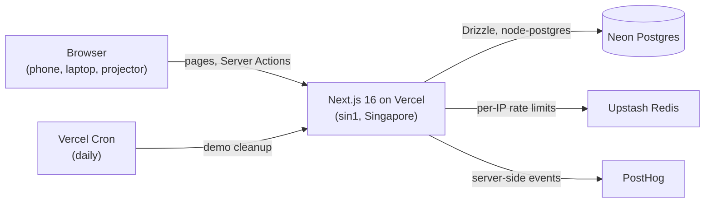

- Pages are server components. Mutations are Server Actions that validate input with Zod and call `server/`.
- A draw writes all its assignments in one transaction.
- PostHog gets events from the server only: no browser script, no cookies, no personal data.

```
app/          routes: landing, /new, /g/[slug] (join, /me, /admin, /reveal), /demo, API routes
components/   UI, the slip, the reveal ring, the landing bowl and video
server/       all business logic: draw, auth, PIN, groups, reveal, demo, rate limits
server/db/    Drizzle schema; SQL migrations in drizzle/
lib/          shared helpers (theme weeks, dates, referrer policy)
tests/        Vitest unit and database tests
e2e/          Playwright specs and the seed script
video/        the Remotion project (its own package.json)
```

More in [docs/TECH.md](docs/TECH.md), [docs/PRODUCT.md](docs/PRODUCT.md) and [docs/ROADMAP.md](docs/ROADMAP.md).

## Tech stack

Next.js 16 (App Router, React 19) · TypeScript (strict) · Tailwind CSS v4 · Neon Postgres · Drizzle ORM · Zod · GSAP · Upstash rate limiting · PostHog (server-side) · Vitest · Playwright · Remotion · Vercel

## Run it locally

You need Node 24 and a Postgres database (a free [Neon](https://neon.tech) branch works).

```bash
git clone https://github.com/CarlosNatanauan/monito-monita.git
cd monito-monita
npm install
cp .env.example .env.local   # set DATABASE_URL; everything else is optional locally
npm run db:migrate
npm run dev                  # http://localhost:3000
```

```bash
npm test            # unit tests
npm run test:db     # database tests (against the database in .env.local)
npm run test:e2e    # Playwright (uses the running dev server)
```

---

Made by Carlos Natanauan · [kuyacarlos.is-a.dev](https://kuyacarlos.is-a.dev) · [LinkedIn](https://www.linkedin.com/in/carlosnatanauan)
